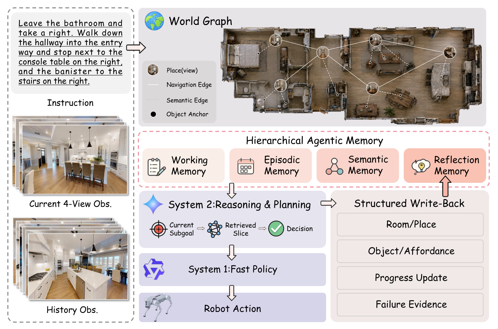
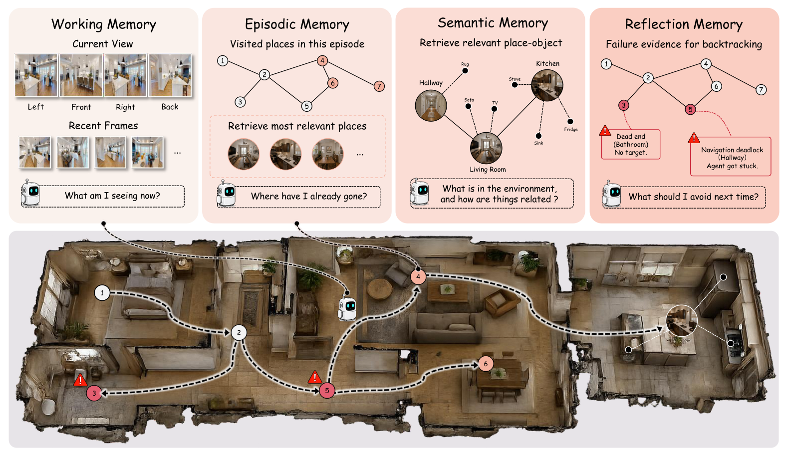

<div align="center">

<h1>HAM-VLN: Harnessing Hierarchical Agentic Memory for Zero-Shot Vision-and-Language Navigation</h1>

<div>
    <a target='_blank'>An Liu<sup>1,2</sup></a>;
    <a target='_blank'>Bingxi Liu<sup>3,4</sup></a>;
    <a target='_blank'>Hongyu Ding<sup>1,5</sup></a>;
    <a target='_blank'>Yixuan Jiang<sup>1,5</sup></a>;
    <a target='_blank'>Yaran Chen<sup>6</sup></a>;
    <a target='_blank'>Fulin Tang<sup>1,2,7</sup></a>;
    <a target='_blank'>Cong Leng<sup>7</sup></a>;
    <a target='_blank'>Hong Zhang<sup>3,4</sup></a>;
    <a target='_blank'>Jian Cheng<sup>1,2</sup></a>
</div>
<br>
<sup>1</sup>CASIA
<sup>2</sup>UCAS
<sup>3</sup>SUSTech
<sup>4</sup>PCL
<sup>5</sup>NJU
<sup>6</sup>XJTLU
<sup>7</sup>MAICRO
<br>
<br>
<div>
    <a href='https://an1iu.github.io/HAM-VLN/' target='_blank'></a>
    <a href='https://arxiv.org/abs/2607.29600' target='_blank'></a>
</div>

</div>

# Abstract

Vision-and-language navigation (VLN) requires agents to ground natural language instructions in visual observations and navigate to target locations. While recent large vision-language models show promise, their application to long-horizon navigation is limited by context length constraints when processing complete visual histories. We introduce HAM-VLN, a training-free framework that addresses this challenge through hierarchical agentic memory. Our system maintains a compact world graph encoding spatial topology and object locations, updated continuously during navigation. Four functional memory views—working, episodic, semantic, and reflection—enable selective retrieval of task-relevant information conditioned on current subgoals. This approach achieves 61.0% success rate on R2R-CE, 52.7% on RxR-CE, and 79.7% on HM3D-v2 ObjectNav without task-specific training, while reducing API token usage by 67.2% compared to full visual history baselines.


## Method Overview

<p align="center">
  <a href="assets/pipeline.pdf">
    
  </a>
</p>
<p align="center"><em>System 2 jointly produces navigation decisions and structured memory writes; System 1 grounds the selected direction for low-level execution.</em></p>


<p align="center">
  <a href="assets/memory.pdf">
    
  </a>
</p>
<p align="center"><em>Four functional memory views over the bounded visual window and persistent place-object world graph.</em></p>


## Installation

The code was tested with Python 3.8, CUDA 11.8, PyTorch 2.4.1, Habitat-Sim 0.1.7, and Habitat-Lab 0.1.7.

All commands below assume that the current directory is `sim-code` unless stated otherwise.

### 1. Create the environment

```bash
conda create -n hamvln python=3.8
conda activate hamvln
```

### 2. Install Habitat-Sim and Habitat-Lab

**Habitat-Sim** 

```bash
git clone https://github.com/facebookresearch/habitat-sim.git
cd habitat-sim
git checkout tags/v0.1.7
pip install -r requirements.txt
CMAKE_ARGS="-DCMAKE_POLICY_VERSION_MINIMUM=3.5" \
  python setup.py install --headless --with-cuda --bullet
cd ..
```

**Habitat-Lab** -  Remove `tensorflow==1.13.1` from `habitat_baselines/rl/requirements.txt` before installing its dependencies to avoid conflict.

```bash
git clone https://github.com/facebookresearch/habitat-lab.git
cd habitat-lab
git checkout tags/v0.1.7

pip install torch==2.4.1+cu118 torchvision==0.19.1+cu118 \
  torchaudio==2.4.1+cu118 \
  --index-url https://download.pytorch.org/whl/cu118

pip install -r requirements.txt
python setup.py develop --all
cd ..
```

### 3. Install GroundingDINO and Segment Anything

```bash
git clone https://github.com/IDEA-Research/GroundingDINO.git
cd GroundingDINO
git checkout 57535c5a79791cb76e36fdb64975271354f10251
pip install -e . --no-build-isolation

pip install 'git+https://github.com/facebookresearch/segment-anything.git'
pip install nltk
```

Following CA-Nav, replace `phrases2classes` in `GroundingDINO/groundingdino/util/inference.py` with edit-distance matching:

```python
from nltk.metrics import edit_distance

@staticmethod
def phrases2classes(phrases: List[str], classes: List[str]) -> np.ndarray:
    class_ids = []
    for phrase in phrases:
        if phrase in classes:
            class_ids.append(classes.index(phrase))
        else:
            distances = np.array([edit_distance(phrase, c) for c in classes])
            class_ids.append(np.argmin(distances))
    return np.array(class_ids)
```

### 4. Install HAM-VLN dependencies

Return to `sim-code/habitat`, then run:

```bash
pip install setuptools==58.5.3 meson-python ninja
pip install -r requirements.txt --use-pep517 --no-build-isolation
pip install -r navdp/requirements.txt
pip install sentence-transformers==3.2.1
```

## Data and Pretrained Models

### Scene datasets

Download the Matterport3D Habitat scenes used by R2R/RxR after obtaining access from the [Matterport3D project](https://niessner.github.io/Matterport/):

```bash
python download_mp.py --task habitat -o data/scene_datasets/mp3d/
```

Download the HM3D-Semantics v0.2 validation scenes from the [HM3D dataset page](https://aihabitat.org/datasets/hm3d/):

```bash
python -m habitat_sim.utils.datasets_download \
  --username <TOKEN_ID> --password <TOKEN_SECRET> \
  --uids hm3d_val_v0.2 --data-path data/scene_datasets/hm3d
```

### Episodes and evaluation subsets

The R2R, RxR, and HM3D-v2 episode annotations and R2R/RxR nDTW ground truth are distributed in this [episode bundle](https://drive.google.com/file/d/1Seiq-2cYVZAb7xX569Mn_PZCDjujNzQa/view). Extract the archive so that its files appear under `data/datasets/episodes/`.

The fixed 100-episode ID lists used in the paper are already included under `data/datasets/stratified_samples/`.

### Model files

1. Download the GroundedSAM checkpoints from this [Google Drive folder](https://drive.google.com/drive/folders/1RvB3z8wi19saplpFYw07NwTdgVkBbH2G).
2. Download the NavDP checkpoint from the [NavDP release](https://github.com/InternRobotics/NavDP#-internvla-n1-system-1-model).
3. HAM-VLN uses BAAI/bge-large-en-v1.5 for graph-memory retrieval. Download the model before evaluation using the same Hugging Face cache configuration as the evaluation process.
```bash
hf download BAAI/bge-large-en-v1.5
```
4. Download `bert-base-uncased` locally for GroundingDINO.

GroundingDINO's text encoder also needs `bert-base-uncased` locally (the eval scripts run offline with `HF_HUB_OFFLINE=1`). Download it from [Hugging Face](https://huggingface.co/google-bert/bert-base-uncased) into `data/grounded_sam/bert-base-uncased/`:

```shell
cd data/grounded_sam && git lfs install && git clone https://huggingface.co/google-bert/bert-base-uncased && cd ../..
```

The eval scripts read it via `BERT_LOCAL_PATH=data/grounded_sam/bert-base-uncased`. Once everything is downloaded, the `data/` directory should be organized as follows:


```text
sim-code/habitat/
├── data/
│   ├── grounded_sam/
│   │   ├── groundingdino_swint_ogc.pth
│   │   ├── GroundingDINO_SwinT_OGC.py
│   │   ├── repvit_sam.pt
│   │   ├── sam_vit_h_4b8939.pth
│   │   └── bert-base-uncased/         # GroundingDINO text encoder
│   ├── datasets/
│   │   ├── episodes/                  # from the Google Drive bundle
│   │   │   ├── vlnce_r2r.json.gz
│   │   │   ├── vlnce_r2r_gt.json.gz
│   │   │   ├── vlnce_rxr.json.gz
│   │   │   ├── vlnce_rxr_gt.json.gz
│   │   │   └── hm3d_v2.json.gz
│   │   └── stratified_samples/        # ships with the code (100-ep ID lists)
│   │       ├── vlnce_r2r.json
│   │       ├── vlnce_rxr.json
│   │       └── hm3d_v2.json
│   └── scene_datasets
│       ├── mp3d                       # 90 MP3D scenes
│       │   ├── 17DRP5sb8fy/           #   each scene: .glb / .house / .navmesh / _semantic.ply
│       │   └── ...
│       └── hm3d                       # HM3D-Sem v0.2 scenes
│           └── hm3d_v0.2/
│               └── val/               # 100 val scenes
│                   ├── 00800-TEEsavR23oF/
│                   └── ...
└── navdp/
    └── navdp-cross-modal.ckpt
```

## API Configuration

HAM-VLN uses two OpenAI-compatible chat-completions endpoints:

- **System 2:** high-level reasoning, progress tracking, memory write-back, and action selection.
- **System 1:** visual grounding of the selected direction and target description.

Create the runtime configuration:

```bash
cp .env.example .env
```

Fill in all six variables:

```dotenv
# ---System2 ---
S2_API_KEY=<system-2-api-key>
S2_BASE_URL=<openai-compatible-base-url>
S2_MODEL_NAME=<system-2-model-id>

# --- System1 ---
S1_API_KEY=<system-1-api-key>
S1_BASE_URL=<openai-compatible-base-url>
S1_MODEL_NAME=<system-1-model-id>
```

The configuration reported in the paper is **Gemini-3.1-Pro** for System 2 and **Qwen3.6-35B** for System 1. Model identifiers are provider-specific; use the exact IDs exposed by your endpoints. The alternative defaults in `.env.example` are convenient development settings, not the model pair used for the paper's reported tables.

## Evaluation

### Run the three paper benchmarks

The portable launchers evaluate the released 100-episode subsets:

```bash
bash eval_scripts/vlnce_r2r.sh
bash eval_scripts/vlnce_rxr.sh
bash eval_scripts/hm3d_v2.sh
```

## Visualization

Runs write per-step frames to `saved_rgb_images/<exp_name>/`. View them with:

```bash
python server.py           # then open `http://localhost:9999/?root=saved_rgb_images/<exp_name>`.
```

## Citation

If you find this work helpful, please consider citing:

```bibtex

@article{liu2026hamvln,
  title={HAM-VLN: Harnessing Hierarchical Agentic Memory for Zero-Shot Vision-and-Language Navigation},
  author={Liu, An and Liu, Bingxi and Ding, Hongyu and Jiang, Yixuan and Chen, Yaran and Tang, Fulin and Leng, Cong and Zhang, Hong and Cheng, Jian},
  journal={arXiv preprint arXiv:2607.29600},
  year={2026}
}
```

## Acknowledgements

This work builds on [LaViRA](https://github.com/NJU-R-L-Group-Embodied-Lab/lavira-code), [CA-Nav](https://github.com/Chenkehan21/CA-Nav-code), [GroundingDINO](https://github.com/IDEA-Research/GroundingDINO), [Segment Anything](https://github.com/facebookresearch/segment-anything), [NavDP](https://github.com/InternRobotics/NavDP), and [Depth Anything V2](https://github.com/DepthAnything/Depth-Anything-V2).
